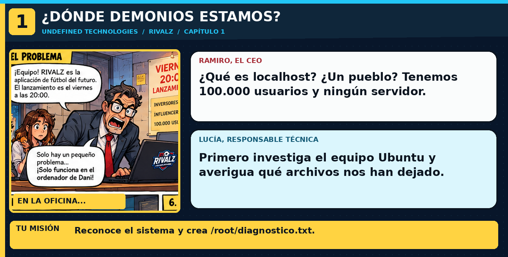

> **En la historia:** Detectar el sistema, el usuario y el kit de RIVALZ. Usa los comandos explicados debajo de esta viñeta; no copies comandos de las ilustraciones.

---

## 🎬 Mensaje de Ramiro
«¿Qué es eso de localhost? Me he gastado un dineral en el logo. ¡La web tiene que salir EN INTERNET!»

**Objetivo:** descubrir dónde estás. **No rompes nada** con estos comandos: solo consultan información.

### Haz esto exactamente
1. Haz clic en la ventana negra de la derecha. Se llama **terminal** y permite hablar con Linux.
2. Copia y ejecuta **una línea cada vez**. Pulsa **Intro** después de cada una:

```bash
whoami
pwd
cat /etc/os-release | head -n 3
ls -l /root/rivalz-kit
```

- `whoami`: quién eres.
- `pwd`: carpeta en la que estás.
- `cat`: lee un archivo.
- `ls -l`: enseña los archivos.

3. Crea una ficha de inspección. Pega **todo este bloque**; al final hay una palabra `EOF`, también debes pegarla:

```bash
cat > /root/diagnostico.txt <<'EOF'
PERSONA: equipo de despliegue de RIVALZ
SISTEMA: Ubuntu Linux
KIT: /root/rivalz-kit
OBJETIVO: publicar una web mediante HTTP
EOF
```

4. Comprueba lo que acabas de escribir:

```bash
cat /root/diagnostico.txt
```

✅ Pulsa **CHECK**. Si aparece un error, revisa letras, guiones y mayúsculas.

**Para pensar y apuntar en tu informe:** ¿qué diferencia hay entre tu ordenador (cliente) y el servidor? ¿Qué es HTTP? **CE orientativos RA1:a,b,h**; tu explicación la comprobará el profesor.
