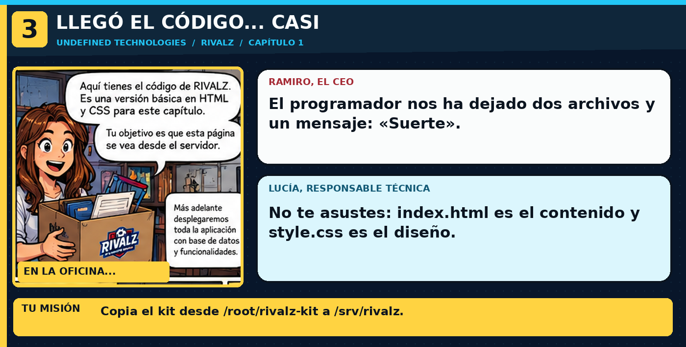

> **En la historia:** Archivos index.html y style.css en su carpeta. Usa los comandos explicados debajo de esta viñeta; no copies comandos de las ilustraciones.

---

## 🎬 Ramiro
«Os he enviado un ZIP... bueno, dos archivos. ¿Eso cuenta como aplicación?»

Por ahora RIVALZ es una **web estática**: HTML define el contenido y CSS le da estilo. Más adelante desplegaréis el backend real.

1. Mira qué te ha dejado el desarrollador:

```bash
ls -l /root/rivalz-kit
```

2. Crea el directorio donde vivirá la web:

```bash
mkdir -p /srv/rivalz
```

3. Copia los dos archivos de la web (el punto final `/.` es importante):

```bash
cp /root/rivalz-kit/. /srv/rivalz/ -r
```

4. Comprueba el resultado:

```bash
ls -l /srv/rivalz
cat /srv/rivalz/index.html | head -n 5
```

`mkdir -p` crea la carpeta si no existe; `cp -r` copia archivos y carpetas. **Todavía no se sirve RIVALZ**: falta decirle a Nginx dónde encontrarla.

Pulsa **CHECK**.
