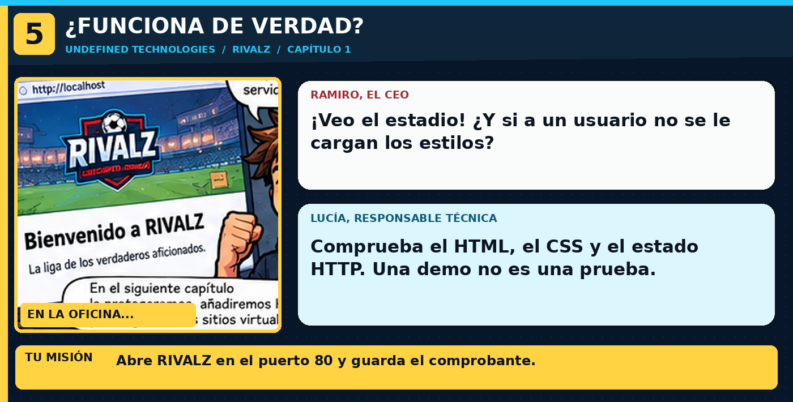

> **En la historia:** Páginas y CSS accesibles; archivo de prueba guardado. Usa los comandos explicados debajo de esta viñeta; no copies comandos de las ilustraciones.

---

## 🎬 Primer inversor
«Me habéis enviado un enlace. Veo RIVALZ. Por primera vez en esta empresa ocurre algo.»

**Objetivo:** demostrar que la web responde y que entrega el CSS.

1. Consulta el estado HTTP del documento principal:

```bash
curl -I http://127.0.0.1/
```

2. Comprueba que el contenido es realmente RIVALZ:

```bash
curl -s http://127.0.0.1/ | grep RIVALZ
```

3. Comprueba el CSS:

```bash
curl -I http://127.0.0.1/style.css
```

4. En Killercoda, abre la vista de tu web con este enlace: **[Abrir RIVALZ en el navegador]({{TRAFFIC_HOST1_80}})**. Si no se abre, arriba a la derecha de la terminal busca la opción **Traffic / Ports** y elige el puerto `80`.

5. Crea un comprobante automático:

```bash
curl -fsS http://127.0.0.1/ -o /root/prueba-rivalz.html
```

`-o` guarda la respuesta en un archivo. Pulsa **CHECK**.
