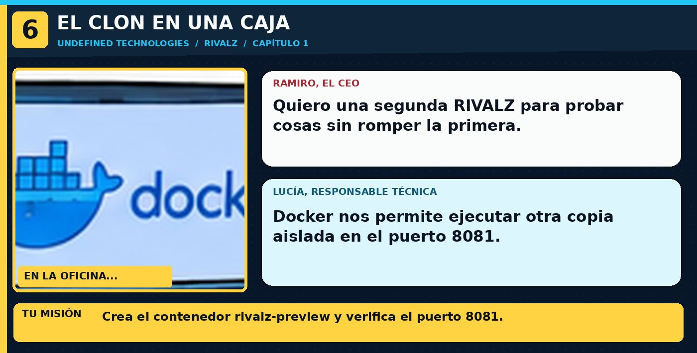

> **En la historia:** Contenedor Nginx funcionando y respondiendo por HTTP. Usa los comandos explicados debajo de esta viñeta; no copies comandos de las ilustraciones.

---

## 🎬 Mensaje del nuevo CTO
«En la demo quiero un entorno separado. ¡Que nadie vuelva a decir que en su portátil funciona!»

Un **contenedor** empaqueta un programa y lo ejecuta aislado. Docker ya viene preparado en este entorno de Killercoda.

1. Comprueba Docker:

```bash
docker --version
```

2. Ejecuta una segunda copia de RIVALZ en el **puerto 8081**, separada del Nginx que acabas de configurar. Pega todo como **una sola línea**:

```bash
docker run -d --name rivalz-preview -p 8081:80 -v /srv/rivalz:/usr/share/nginx/html:ro nginx:alpine
```

- `-d`: ejecución en segundo plano.
- `--name`: nombre del contenedor.
- `-p 8081:80`: puerto externo 8081, interno 80.
- `-v ...:ro`: la carpeta de RIVALZ se monta en **solo lectura**.
- `nginx:alpine`: imagen de Nginx pequeña (la primera descarga puede tardar).

3. Comprueba:

```bash
docker ps
curl -I http://127.0.0.1:8081/
```

4. Abre la vista del contenedor: **[RIVALZ en Docker]({{TRAFFIC_HOST1_8081}})**.

**Si aparece `Conflict. The container name is already in use`:** no repitas `docker run`, simplemente mira `docker ps`.

Pulsa **CHECK**.
