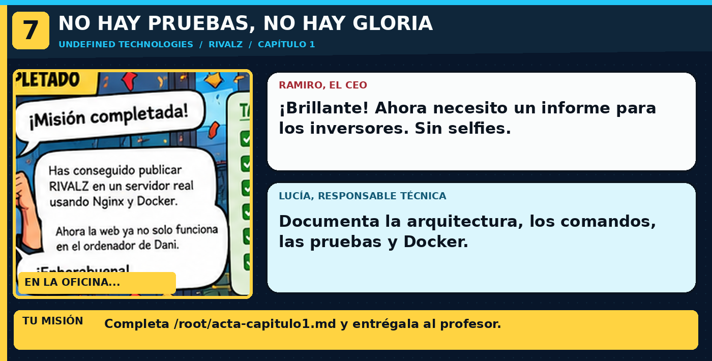

> **En la historia:** Acta con respuestas propias y evidencias del despliegue. Usa los comandos explicados debajo de esta viñeta; no copies comandos de las ilustraciones.

---

## 🎬 Ramiro
«¡Ha funcionado! Necesito un documento que pueda enseñar al inversor. Y sin emoticonos, que es muy serio.»

**Objetivo:** documentar, no memorizar comandos. Tu profesor leerá el contenido. El verificador solo comprueba que has creado las secciones.

1. Crea tu documento:

```bash
cat > /root/acta-capitulo1.md <<'EOF'
# Acta del capítulo 1 - RIVALZ
## Arquitectura
Cliente navegador: [explica aquí para qué sirve]
Servidor Nginx: [explica aquí para qué sirve]
Protocolo HTTP: [explica aquí para qué sirve]
## Archivos de la aplicación
HTML: [explica su función]
CSS: [explica su función]
## Requisitos para publicar
[escribe aquí los programas, carpetas y puertos necesarios]
## Comandos utilizados
[resume los comandos más importantes y su función]
## Pruebas realizadas
[describe tus pruebas y los resultados]
## Comparación Nginx normal y Docker
[explica una ventaja y una limitación de cada opción]
EOF
```

2. Edita las respuestas entre corchetes. La forma más sencilla es abrir el **IDE / Editor** de Killercoda y abrir `/root/acta-capitulo1.md`. Alternativamente, puedes usar `nano /root/acta-capitulo1.md` (guardar: `Ctrl+O`, Intro; salir: `Ctrl+X`).

3. Revisa:

```bash
cat /root/acta-capitulo1.md
```

4. **Entrega** a tu profesor una copia del acta y las capturas que te solicite; Killercoda puede borrar los archivos al cerrar la sesión. Pulsa **CHECK**.
